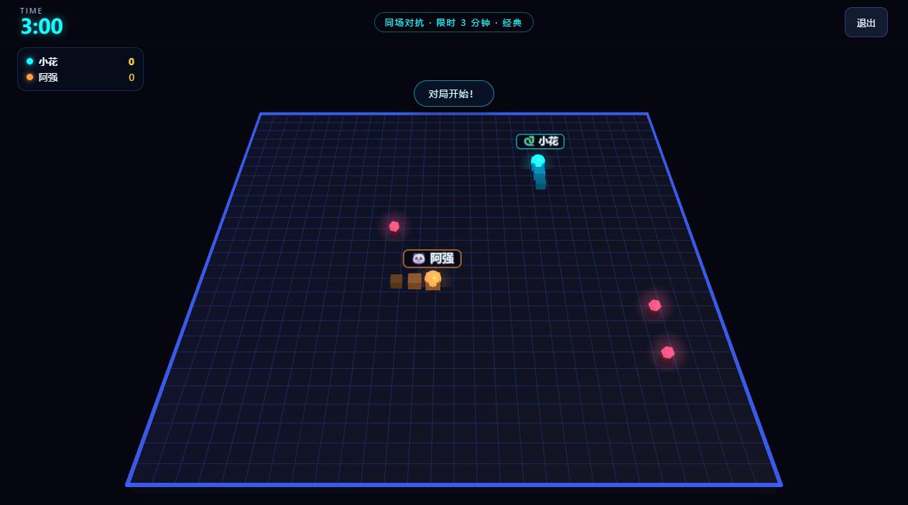
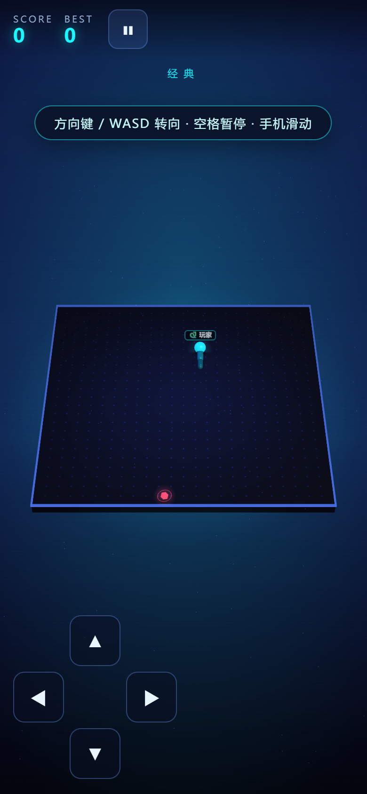

# 霓虹贪吃蛇 3D · Neon Snake 3D

Three.js 3D 贪吃蛇：保留经典玩法（三档难度 / 5 种果实 / 连击 / 成就），新增**局域网联机**（最多 8 人、三种玩法 × 两种节奏）与**个人资料**（昵称 / 头像 / 颜色，联机头顶显示昵称牌）。




## 永久网址

- **单人 3D（GitHub Pages）**：https://yjm-only1.github.io/neon-snake-3d/
- **局域网联机**：需一台主机运行本仓库的 `node server/server.mjs`（GitHub Pages 只能单人）
- 经典 2D 版（旧）：https://yjm-only1.github.io/neon-snake/

## 单人 3D

- 双击根目录 `index.html`（构建产物）即玩；或运行局域网服务器后在浏览器打开
- 三档难度（各有独立最高分）：悠闲 6 格/秒穿墙 · 经典 8 格/秒撞墙死 · 狂暴 11 格/秒加速最陡
- 5 种果实（普通 / 金果 / 护盾 / 减速 / 双倍）+ 3 秒连击 ×2~×5
- 个人资料：昵称、头像（emoji）、颜色，蛇头顶实时显示昵称牌
- 三套皮肤：霓虹 / 极光 / 熔岩；两档画质：高清 / 流畅（设置里实时切换并保存）

## 皮肤与画质

设置 → 皮肤 / 画质：皮肤影响底板质感、点阵、边框光晕、背景与灯光；画质为「流畅」时降低渲染分辨率并关闭尘埃、光晕、阴影等装饰，低端手机更稳。


## 局域网联机（最多 8 人）

浏览器之间不能直接互连，需要一台电脑当“房间”。**最简单的一键开房（Windows）**：

> 双击 `一键开房间.bat` → 自动启动房间并打开浏览器 → 大厅里出现**邀请二维码 + 局域网地址** → 朋友扫码或输入地址即可加入，无需安装任何东西。

命令行方式（macOS / Linux / 手动）：

```bash
node server/server.mjs
# 服务器会打印地址，例如：
#   本机访问:   http://localhost:8787
#   局域网访问: http://192.168.1.5:8787
```

所有人（含主机）用**局域网地址**打开页面 → 点「局域网联机」→ 填昵称 → 加入房间；首位进房者是房主，可改玩法/节奏/难度并开始。

### 联机玩法矩阵

| 玩法 | 限时 3 分钟（死亡 3 秒重生） | 生存淘汰（最后存活者胜） |
|---|---|---|
| 抢食竞速（共享地图 · 互不伤害） | ✅ | ✅ |
| 同场对抗（共享地图 · 撞蛇身死） | ✅ | ✅ |
| 各自竞速（独立地图 · 同种子食物） | ✅ | —（无淘汰意义，固定限时） |

- **56×56 大战场**（面积约为原来的 4 倍），镜头平滑跟随自己的蛇，到地图边缘自动停住，墙始终存在
- 右下角**小地图**显示所有玩家与食物位置，大图不迷路
- 新食物围绕存活玩家附近刷新，大图里紧跟战斗节奏；各自竞速模式全员同点出生、同种子食物
- 联机计分板实时显示每人分数与阵亡状态
- 每条蛇头顶显示「头像 + 昵称」昵称牌，颜色由个人资料决定
- 断线 / 关页面自动移出房间；服务器 12 秒心跳超时清理

## 常见问题

- **双击 `一键开房间.bat` 没反应**：批处理必须是 Windows CRLF 换行（仓库已修正为 CRLF）；若仍无反应，打开命令行执行 `start-server.bat` 查看具体报错
- **端口 8787 被占用**：说明已有一个房间在运行，直接访问 `http://localhost:8787`；或换端口 `node server/server.mjs 8788`
- **朋友打不开**：确认同一 Wi-Fi、首次运行时 Windows 防火墙已允许 Node.js、使用服务器打印的 `192.168.x.x` 地址（不要用 localhost）
- **Windows 安全提示**：若弹出“Windows 已保护你的电脑”，点「更多信息 → 仍要运行」

## 操作

| 输入 | 动作 |
|---|---|
| 方向键 / WASD | 转向（缓冲 2 步，禁止 180° 反转） |
| 空格 / Esc | 暂停（仅单人） |
| Enter | 菜单开局 / 结算重开 |
| M | 静音音效 |
| 手机滑动屏幕 | 转向 |
| 手机触屏方向键 | 转向（触屏设备自动显示） |

## 手机浏览器

- 手机直接打开 https://yjm-only1.github.io/neon-snake-3d/ 即可单人游玩（竖屏适配、滑动转向、触屏方向键）
- 局域网联机：手机扫主机大厅的二维码即可加入；**主机需要一台电脑**运行房间服务
- 低端机建议在 设置 → 画质 切换到「流畅」



## 项目结构

```
index.html / deploy-site/index.html   单文件构建产物（双击即玩）
dev.html                              源码页面（需本地服务器）
src/config.js                         难度 / 食物 / 联机参数 / 头像颜色 / 成就
src/game.js                           单人模拟（纯逻辑，Node 可测）
src/mp/arena.js                       联机权威模拟（服务端复用）
src/render3d.js                       Three.js 3D 渲染（透视相机 / 昵称牌 / 粒子）
src/net.js                            联机客户端（SSE 快照流）
src/ui.js                             菜单 / 大厅 / HUD / 结算 / 个人资料
src/main.js                           状态机 + 主循环
server/server.mjs                     零依赖局域网服务器（HTTP + SSE + 邀请二维码）
一键开房间.bat                        Windows 一键开房（自动开浏览器）
vendor/three.module.js                Three.js r160
vendor/qr/qrcode.mjs                  二维码生成（qrcode-generator, MIT）
tools/build_single.py                 单文件构建
tools/sim/arena-selftest.mjs          联机逻辑自测（59 断言）
tools/e2e/server-test.mjs             服务器集成测试（20 断言）
tools/e2e/browser-test.mjs            单人 3D 浏览器验收（14 断言）
tools/e2e/lan-browser-test.mjs        双人联机浏览器验收（19 断言）
tools/e2e/mobile-test.mjs             手机触屏验收（7 断言）
```

## 测试与构建

```bash
node tools/sim/arena-selftest.mjs    # 联机逻辑
node tools/e2e/server-test.mjs       # 服务器集成（含邀请二维码接口）
node tools/e2e/browser-test.mjs      # 单人 3D + 皮肤/画质（需本机 Chrome）
node tools/e2e/lan-browser-test.mjs  # 双人联机 + 邀请面板（需本机 Chrome）
node tools/e2e/mobile-test.mjs       # 手机触屏方向键（需本机 Chrome）
python tools/build_single.py         # 重建 index.html 与 deploy-site/index.html
```

## 技术要点

- 服务端权威：Node 复用 `src/mp/arena.js` 跑模拟，浏览器只上报转向、接收 15Hz 快照并插值渲染
- 传输零依赖：HTTP POST 上报输入 + SSE 推送快照，局域网延迟通常 <10ms，无需 npm install
- 3D：透视斜俯视相机、胶囊连体蛇（InstancedMesh）、点阵玻璃底板、悬浮果实、粒子与震屏
- 性能：静态底板一次烘焙、昵称牌/果实材质按需创建、画质档降分辨率并关闭装饰层
- GitHub Pages 只提供单人 3D；联机必须通过局域网服务器

## 发布

公开仓库发布整个 `neon-snake-3d` 工程；仓库根目录即本工程目录，工程目录之外的任何文件不得进入。

```bash
bash tools/publish_site.sh   # 构建并推送到 GitHub main，Pages 自动发布
```